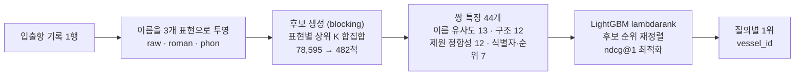

# 항만 선박 매칭 AI — 음소 정규화 파이프라인 프로젝트 로그

<aside>
🎯

**한 줄 요약** — 입출항 기록 한 행(한글 또는 영문 선박명 + 톤수·국적·선종)을 받아, 78,595척 영문 카탈로그에서 같은 배의 `vessel_id`를 찾는 문제입니다.

**핵심은 표기를 바꾸는 것이 아니라 양쪽을 같은 음운 공간으로 옮기는 것**입니다. `글로비스`와 `GLOVIS`가 같은 음소열로 만나면서 한글 정확도가 59% → 99%로 올랐습니다.

**5-fold 교차검증 가중 점수 0.9933** (한글 0.9908 / 비한글 0.9993)

</aside>

> **이 문서의 위치**
>
> 같은 대회의 기존 기록(v1~v4, 리더보드 0.98544)과는 **독립적으로 개발된 파이프라인**입니다.
> 모델(LightGBM lambdarank), 특징 수(44), 검증 방식이 다르므로 점수를 직접 비교하면 안 됩니다.
> 공통점은 문제 정의와 평가 산식뿐입니다.

---

## 목차

1. [대회 한눈에 보기](#1-대회-한눈에-보기)
2. [왜 어려운가 — 데이터에서 찾은 것](#2-왜-어려운가--데이터에서-찾은-것)
3. [접근 방법](#3-접근-방법)
4. [핵심 아이디어 — 음소 정규화](#4-핵심-아이디어--음소-정규화)
5. [검증 결과](#5-검증-결과)
6. [특징 중요도](#6-특징-중요도)
7. [제출 기록](#7-제출-기록)
8. [실험 기록](#8-실험-기록)
9. [버그와 교훈](#9-버그와-교훈)
10. [리더보드 분석](#10-리더보드-분석)
11. [다음 개발 방향](#11-다음-개발-방향)
12. [다음 계획](#12-다음-계획)
13. [프로젝트 구조](#13-프로젝트-구조)
14. [제출 규격 준수](#14-제출-규격-준수)
15. [실행 방법](#15-실행-방법)
16. [참고](#16-참고)

---

## 1. 대회 한눈에 보기

| 항목 | 내용 |
| --- | --- |
| **대회** | 항만 문제해결을 위한 AI 기술 공모전 |
| **주최** | 해양수산부 |
| **주관** | 울산항만공사 · 한국정보산업연합회 |
| **운영** | 데이콘 |
| **과제** | 엔티티 매칭 — 입출항 기록 1행 → 카탈로그 선박 1척의 `vessel_id` |
| **평가** | 0.7 × 한글 기록 정확도 + 0.3 × 비한글 기록 정확도 |
| **제출** | 코드 제출 (`submit.zip`) |
| **일정** | 11/9 발표자료 PDF 제출 · 11/10 서울비즈센터 본선 발표 |

<br>

**평가 산식 세부**

- 한글 / 비한글 구분은 **기록에 적힌 선박명**을 기준으로 합니다.
- 리더보드는 3,000행 전체이며 Public = Private 입니다.

**제출 환경 제약**

| 항목 | 값 |
| --- | --- |
| 구조 | `model/`, `script.py`, `requirements.txt` 를 zip 최상위에 |
| 인터넷 | 불가 (패키지 설치 이후) |
| 시간 제한 | 설치 10분 · 추론 20분 |
| 제출 횟수 | 하루 3회 |

**데이터 규칙**

- `train.csv` + `vessel_catalog.csv` **만** 사용합니다.
- 외부 선박 DB·정답 매핑표는 금지, 공개 사전학습 가중치는 허용입니다.
- **평가 행 독립** — 각 테스트 행은 그 행의 입력과 공식 데이터만으로 예측해야 합니다. 같은 행을 단독·부분집합·순서변경으로 돌려도 같은 값이 나와야 합니다.

**데이터 규모**

| 파일 | 크기 |
| --- | --- |
| `train.csv` | 12,222 × 9 |
| `vessel_catalog.csv` | 78,595 × 8 |
| 평가 대상 | 3,000 행 |

---

## 2. 왜 어려운가 — 데이터에서 찾은 것

### 2.1 한글명은 영문명을 소리 나는 대로 적은 것

```
모닝쿠리어          →  Morning Courier
글로비스 세이프티   →  Glovis Safety
제7하나             →  No. 7 Hana
아세안 캡틴         →  Asian Captain
```

카탈로그에는 한글이 **0%** 라서 글자 비교가 통하지 않습니다.

<br>

### 2.2 소수 집단이 점수의 대부분을 결정

- 한글 기록은 train의 **9.7%** (1,191행 / 고유 382척)뿐입니다.
- 그런데 평가 가중치는 **70%** 입니다.

<br>

### 2.3 문자열 비교가 원천적으로 불가능

| 대상 | 측정값 |
| --- | --- |
| 한글명 ↔ 정답 카탈로그명 정규화 편집유사도 | **0.010** (사실상 무작위) |
| 비한글명 편집거리 ≤ 2 비율 | 88.4% |
| 영문명 완전일치율 | 58.3% |

영문명의 나머지 41.7%는 1~2글자 오타(글자 교환·누락·중복)입니다.

<br>

### 2.4 제원은 신뢰할 수 있지만 결정 근거는 못 됨

- 총톤수 상대오차 ≤ 5% 비율이 **97.7%** 로 신뢰할 만합니다.
- 다만 **톤수만으로는 후보가 평균 1,228척**이라 단독 결정 근거가 될 수 없습니다.

<br>

### 2.5 범주형 값의 언어 불일치

국적·선종은 기록이 한글, 카탈로그가 영문이고 **다대다**입니다.

```
파나마  →  Panama  79.6%
           (나머지 20%는 South Korea·Liberia·Marshall Islands 등으로 갈림)
```

<br>

### 2.6 `call_sign` 은 결정론적 식별자

- train 안에서 고유값 **5,851개**가 정답과 **1:1** 입니다.
- 한 값이 두 선박을 가리키는 경우는 **0건** 입니다.

<br>

### 2.7 그리고 전부 행 단위로 계산됨

전역 분포를 쓰지 않으므로 **행 독립성 규칙을 구조적으로 만족**합니다.

---

## 3. 접근 방법



<br>

**1단계 — 표현 투영** (`text.py`)

이름을 `raw`(영숫자 원문) · `roman`(자모 로마자) · `phon`(음소 정규화) 세 가지로 봅니다. `phon` 이 핵심입니다.

<br>

**2단계 — 후보 생성** (`index.py`)

표현별 상위 K의 **합집합**에 `call_sign` 조회 결과를 **강제 포함**합니다. 정답이 후보에 없으면 이후 단계에서 복구할 수 없으므로 재현율이 전부입니다.

<br>

**3단계 — 특징 44개** (`features.py`)

| 가족 | 개수 | 내용 |
| --- | ---: | --- |
| A. 이름 유사도 | 13 | Levenshtein · Jaro-Winkler · token_set · partial |
| B. 이름 구조 | 12 | 길이 · 머리글자 · 숫자 · 토큰 겹침 |
| C. 제원 정합성 | 12 | 세 톤수 정의별 상대오차 · 선종·국적 조건부확률 |
| D. 식별자·순위 | 7 | 조회 적중 · 후보 내 순위 · 후보 수 |

<br>

**4단계 — 순위 재정렬** (`ranker.py`)

`lambdarank`, `ndcg@1` 최적화입니다. 정답은 후보 안에 최대 하나뿐이므로 분류가 아니라 **순위 문제**입니다.

<br>

**5단계 — 행 독립성** (`pipeline.py`)

`call_sign` 조회표는 `train.csv` 만으로 만들고 `model/` 에 동결합니다. 교차검증에서도 자기 fold를 제외한 나머지로 만들어 평가 조건을 정확히 재현합니다.

---

## 4. 핵심 아이디어 — 음소 정규화

한글을 영문으로 **되돌리는** 것이 아니라, 양쪽을 **같은 음소 공간으로 옮깁니다.**

### 4.1 사상 규칙

```
초성   ㄱㄲ→K  ㄴ→N  ㄷㄸ→T  ㄹ→L  ㅁ→M  ㅂㅃ→P
       ㅅㅆ→S  ㅇ→묵음  ㅈㅉㅊ→C  ㅋ→K  ㅌ→T  ㅍ→P  ㅎ→H

중성   ㅏ→A  ㅓㅗ→O  ㅜ→U  ㅣ→I  ㅔㅖ→E  ㅡ→삭제

종성   ㄱㄲㅋ→K  ㄴㄵㄶ→N  ㄷㅅㅆㅈㅊㅌ→T  ㄹ→L
       ㅁ→M  ㅂㅍㅄ→P  ㅇ→NG  ㅎ→H

영문   PH→P  TH→T  SH→S  CH→C  CK→K  QU→K  X→KS
       B·F·V→P   G·C·Q→K   D→T   R→L   Z→S   J→C
       중복 자음 축약 (LL→L)
```

<br>

### 4.2 설계 판단 두 가지

**① 파열음의 유·무성 대립을 합칩니다**

`G/K`, `B/P`, `F/P`, `D/T` 구분은 한글 음차에서 일관되지 않습니다. 합치는 쪽이 유리했습니다.

**② `ㅡ` 를 삭제합니다**

`글로비스` 의 `ㅡ` 는 자음충돌 방지용 삽입모음이지 발음이 아닙니다. 버려야 `GLOVIS` 와 만납니다.

<br>

### 4.3 실제 변환 예시

```
글로비스 세이프티   →  KLLOPISSEIPTI      Glovis Safety  →  KLOPISAPETY    (겹ㄹ 하나 차이)

뉴콘크              →  NYUKONK            New Konk       →  NEWKONK

펭슈하이            →  PENGSYUHAI         Feng Xiu Hai   →  PENKSIUHAI
```

<br>

### 4.4 표현별 재현율 (한글 고유명 382척 기준)

| 표현 | top-1 | top-50 |
| --- | ---: | ---: |
| `raw` (원문 영숫자) | 0.000 | 0.021 |
| `roman` (자모 로마자) | 0.508 | 0.825 |
| **`phon` (음소 정규화)** | **0.618** | **0.887** |

원문 비교는 한글에서 **완전히 실패**합니다. 음소 정규화가 이 문제를 푸는 유일한 열쇠입니다.

---

## 5. 검증 결과

### 5.1 교차검증 요약

| 검증 설정 | 가중 | 한글 | 비한글 |
| --- | ---: | ---: | ---: |
| 이름 유사도 단독 (베이스라인) | 0.7058 | 0.5928 | 0.9694 |
| 선박 단위 분할 · 이름+제원만 (**최악**) | 0.9409 | 0.9160 | 0.9990 |
| 행 분할 · 이름+제원만 | 0.9745 | 0.9639 | 0.9991 |
| **행 분할 · `call_sign` 이력 포함 (제출 번들)** | **0.9933** | **0.9908** | **0.9993** |

<br>

**두 분할의 의미**

| 분할 | 설명 |
| --- | --- |
| **행 분할** | 무작위 행 분할. 실제 평가 데이터(3,000행)와 조건이 같음 |
| **선박 단위 분할** | 학습에서 본 적 없는 선박만 평가에 등장하는 최악 조건 |

0.9409 와 0.9933 의 **간격이 곧 일반화 비용**입니다.

<br>

### 5.2 후보 생성 성능

| 항목 | 값 |
| --- | ---: |
| 재현율 (정답이 후보에 포함) | **0.9993** |
| 후보 중앙값 | **482척** |
| 원래 카탈로그 크기 | 78,595척 |

<br>

### 5.3 실행 비용

| 항목 | 값 | 제한 |
| --- | ---: | ---: |
| 학습 (전체, CPU) | 약 13분 | — |
| 추론 (200행) | **15.7초** | 20분 |
| `submit.zip` | 0.9MB (모델 2.3MB) | 10GB |
| GPU | 불필요 | L4 제공 |

---

## 6. 특징 중요도

LightGBM `gain` 기준입니다.

### 6.1 주력 신호 (1~10위)

| 순위 | 특징 | gain | 해석 |
| ---: | --- | ---: | --- |
| 1 | `rank_phon` | 2,316,192 | 음소 유사도의 후보 내 순위 — **압도적 1위** |
| 2 | `lev_max` | 192,829 | 세 표현 편집유사도의 최댓값 |
| 3 | `cs_hit` | 144,696 | `call_sign` 조회 적중 (결정론적 식별자) |
| 4 | `gt_gap` | 38,352 | 총톤수 상대오차 |
| 5 | `rank_roman` | 15,938 | 자모 로마자 유사도의 후보 내 순위 |
| 6 | `gap_within5` | 14,760 | 톤수 오차가 5% 이내인가 |
| 7 | `n_candidates` | 14,109 | 후보 수 = 난이도 |
| 8 | `gap_min` | 8,343 | 세 톤수 정의 중 최소 오차 |
| 9 | `type_prob` | 6,215 | 선종 조건부확률 |
| 10 | `tok_roman` | 5,099 | 어순 무관 이름 유사도 |

<br>

### 6.2 보조 신호 (11~20위)

| 순위 | 특징 | gain | 해석 |
| ---: | --- | ---: | --- |
| 11 | `lev_std` | 4,157 | 세 표현 간 유사도 편차 (표현 불일치 신호) |
| 12 | `jw_roman` | 4,087 | 자모 Jaro-Winkler |
| 13 | `rank_raw` | 1,985 | 원문 유사도 순위 |
| 14 | `jw_raw` | 1,949 | 원문 Jaro-Winkler |
| 15 | `lev_raw` | 1,803 | 원문 편집유사도 |
| 16 | `flag_prob` | 826 | 국적 조건부확률 |
| 17 | `part_roman` | 730 | 자모 부분 문자열 일치 |
| 18 | `cs_known` | 683 | `call_sign` 조회가 가능한가 |
| 19 | `lev_phon` | 582 | 음소 편집유사도 |
| 20 | `jw_phon` | 575 | 음소 Jaro-Winkler |

<br>

### 6.3 해석

`rank_phon` 이 압도적 1위입니다.

후보 482척 안에서 **음소 유사도 순위**가 사실상 결정을 내리고, 톤수·선종·국적·`call_sign` 같은 나머지 신호가 **동점을 깨는** 역할을 합니다. 이 구조 덕분에 제원이 비어 있는 행에서도 이름만으로 판단할 수 있습니다.

> 중요도는 LightGBM `gain` 기준입니다.
> sklearn 래퍼의 기본값(`split` 횟수)과 값이 다르므로, 학습 직후와 저장된 모델 복원 후가 같은 값을 보이도록 코드에서 gain 으로 통일했습니다.

---

## 7. 제출 기록

| 제출 | 내용 | LB | 비고 |
| --- | --- | --- | --- |
| — | 음소 정규화 파이프라인 (`submit.zip` 0.9MB) | 미제출 | 교차검증 0.9933. 리더보드 제출 후 갱신 예정 |

> ⚠️ 이 파이프라인은 **아직 실제 리더보드에 제출하지 않았습니다.**
> 위 검증 수치는 모두 학습 데이터를 분할한 결과이며 **리더보드 점수가 아닙니다.**

---

## 8. 실험 기록

### 8.1 실험 요약

| # | 실험 | 결론 |
| ---: | --- | --- |
| 1 | 표현별 재현율 | 음소 정규화가 한글 문제의 정답 |
| 2 | 음소 사상 정밀화 | 유·무성 병합 + 삽입모음 제거 채택 |
| 3 | 제원 하드 필터 | **필터가 아니라 특징으로 써야 한다** |
| 4 | 후보 크기 K | K=300, 한글 질의 4배 확대 |
| 5 | `call_sign` 조회 | 후보 강제 포함으로 재현율 0.9968 → 0.9993 |
| 6 | 최종 교차검증 | 행 분할 0.9933 / 최악 0.9409 |
| 7 | 제출 코드 실행 | 제한 20분 대비 충분 |
| 8 | 텍스트 엔진 정밀화 | 순차 전역 치환은 앞 결과를 덮어쓴다 |

<br>

### 8.2 실험 1 — 표현별 재현율

**목적** 어떤 표현이 정답을 후보에 넣는가

**결과**

| 표현 | top-1 | top-50 |
| --- | ---: | ---: |
| `raw` | 0.000 | 0.021 |
| `roman` | 0.508 | 0.825 |
| `phon` | **0.618** | **0.887** |

**결론** 음소 정규화가 한글 문제의 정답입니다.

<br>

### 8.3 실험 3 — 제원 하드 필터

**목적** 제원으로 후보를 좁힐 수 있는가

**결과**

| 블로킹 조건 | 후보 중앙값 | 재현율 | top-1 |
| --- | ---: | ---: | ---: |
| 필터 없음 (K=300) | 482 | 0.9968 | 0.618 |
| K=300 · 한글 2배 | 545 | 0.9954 | — |
| K=300 · 한글 4배 | 661 | **0.9961** | — |
| K=300 · 한글 6배 | 775 | 0.9971 | — |
| 톤수 ±5%만 (비교군) | 1,139 | 0.895 | 0.709 |
| 톤수 ±20% + 국적 (비교군) | 216 | 0.778 | 0.657 |
| 톤수 ±20% + 선종 + 국적 (비교군) | 31 | 0.584 | 0.529 |

> **측정 시점 주의** — `top-1` 값은 영문 규칙 **단일 패스 수정 이전**에 측정한 것입니다
> ('필터 없음' 행만 수정 후 값 0.618 로 갱신).
> 재현율은 음소 키가 아니라 **후보 집합 크기**에 좌우되므로 수정 후에도 결론은 그대로입니다.

**결론** 제원 필터는 후보를 극적으로 줄이지만 **정답을 함께 버립니다.** 필터가 아니라 특징으로 써야 합니다.

한글 4배 확대는 평균 후보쌍을 487 → 661로만 늘리면서 재현율을 0.9387 → 0.9647로 올립니다.

<br>

### 8.4 실험 5 — `call_sign` 조회

**목적** 식별자를 쓸 수 있는가

**결과**

| 항목 | 값 |
| --- | ---: |
| 학습분 존재율 | 0.688 ~ 0.707 |
| 존재 시 조회 정확도 | **1.0000** |
| 한글 기록의 존재율 | 0.918 |

**결론** 후보 강제 포함으로 재현율이 0.9968 → 0.9993 으로 올랐습니다.

<br>

### 8.5 실험 7 — 제출 코드 실행

| 항목 | 결과 |
| --- | --- |
| 추론 시간 (200행) | 15.7초 |
| 결측 예측 | 0건 |
| 카탈로그 밖 ID | 0건 |
| 행 독립성 (단독·부분집합·순서변경) | 예측 동일 (테스트로 검증) |
| 단위 테스트 | 45개 통과 |

<br>

### 8.6 실험 8 — 텍스트 엔진 정밀화

**목적** 버그 수정이 성능에 미치는 영향 측정

| 변형 | 한글 top-1 | 한글 top-50 | 비한글 top-1 |
| --- | ---: | ---: | ---: |
| 영문 규칙 순차 전역 치환 (기존) | 0.589 | 0.874 | 0.970 |
| **영문 규칙 단일 패스 (수정)** | **0.618** | **0.887** | **0.976** |
| 단일 패스 + 쌍자음 병합 | 0.586 | 0.895 | 0.974 |

**결론** 순차 전역 치환은 앞 규칙의 결과를 뒤 규칙이 덮어씁니다.

<br>

### 8.7 실패한 접근 (기록)

| 접근 | 한글 top-1 | 왜 실패했나 |
| --- | ---: | --- |
| 표준 로마자 표기법(RR) 변환 | 0.000 | 실제 표기가 RR을 따르지 않음 |
| 다국어 임베딩(LaBSE/MiniLM) 유사도 | 0.047 | 학습 분포에 한글 선박명이 없음 |
| 자모 자음골격(consonant skeleton) | 0.011 | 모음을 모두 버리면 변별력이 사라짐 |
| 제원 하드 필터 | 재현율 0.584 | 정답이 후보에서 사라짐 |
| 쌍자음 병합(겹ㄹ→ㄹ) | 0.586 (↓) | `top1`은 내려가고 `top50`만 올라 상쇄 |

---

## 9. 버그와 교훈

단위 테스트 45개가 실제 버그 **4건**을 잡았습니다. 포트폴리오 관점에서 가장 값진 기록입니다.

### 9.1 자모 분해 반환값 불일치

| 항목 | 내용 |
| --- | --- |
| **증상** | 즉시 크래시 |
| **원인** | 비한글 경로가 2-튜플, 한글 경로가 4-튜플 반환 |
| **영향** | 실행 불가 |

<br>

### 9.2 중성 인덱스 falsy 판정

| 항목 | 내용 |
| --- | --- |
| **증상** | `라온` → `LAON` (r이어야 함) |
| **원인** | `ㅏ` 가 중성 인덱스 **0** 이라 `if jung` 이 거짓으로 평가됨 |
| **영향** | 한글 top-1 0.500 → 0.508 |

<br>

### 9.3 순차 전역 치환

| 항목 | 내용 |
| --- | --- |
| **증상** | `CHAMPION` → `KAMPION` |
| **원인** | `CH→C` 로 만든 `C` 를 뒤의 `C→K` 가 다시 덮어씀 |
| **영향** | 한글 top-1 0.589 → 0.618 손실 |

<br>

### 9.4 후보 전량 선택 시 정렬 생략

| 항목 | 내용 |
| --- | --- |
| **증상** | 후보가 카탈로그 앞쪽에만 몰림 |
| **원인** | `k ≥ n` 일 때 `argsort` 를 건너뜀 |
| **영향** | 데모 데이터에서 재현율 0.30 (실데이터 미발현) |

<br>

### 9.5 교훈

> **측정하지 않은 것을 최적화하지 말 것.**
>
> 텍스트 엔진 수정만으로 이름 단독 베이스라인이 0.6949 → 0.7058 로, 한글이 0.5785 → 0.5928 로 올랐습니다.
> 이 차이는 랭커가 아니라 **표현 계층**에서 나온 것입니다.

---

## 10. 리더보드 분석

이 파이프라인의 리더보드 점수는 아직 없습니다. 다만 남은 개선 여지를 정량화하면 다음과 같습니다.

### 10.1 점수 가중치

| 대상 | 행 수 | 가중치 | 1행당 점수 |
| --- | ---: | ---: | ---: |
| 한글 | 300 | 0.7 | **0.00233** |
| 비한글 | 2,700 | 0.3 | **0.00011** |

**한글 1행이 비한글 21행과 같습니다.**

<br>

### 10.2 남은 여지

- 비한글은 이미 0.9993 이라 남은 점수는 사실상 **한글에만** 있습니다.
- 교차검증 기준 한글 오답은 11행(0.9908)입니다.
- 이 11행을 절반으로 줄이면 **+0.0128** 입니다.

---

## 11. 다음 개발 방향

한글 집중 전략입니다.

**① 동명 선박 대응**

이름 특징이 만점 동점이 되면 제원에만 의존합니다. 후보 간 pairwise 비교 특징을 추가합니다.

**② 학습 기반 음차 복원**

현재 규칙은 수작업이라 중국어·일본어 음차에 약합니다 (`펭슈하이 → Feng Xiu Hai` 유사도 0.71). seq2seq로 대체합니다.

**③ 한글 자모 단위 오타 증강**

지금 학습 데이터는 실제 분포를 그대로 씁니다. 받침·모음이 바뀐 표기 변형을 증강합니다.

**④ 후보 top-5 + 근거 특징 출력**

실무 수용성을 위해 정답 하나가 아니라 후보와 근거를 함께 제시합니다.

**⑤ 시드 앙상블**

랭커 시드를 바꿔 2~3개를 평균합니다.

**⑥ 후보 K 확대**

서버 여유(추론 20분 대비 1분)를 활용해 K=500까지 올려 후보 재현율 상한을 올립니다.

---

## 12. 다음 계획

**완료**

- [x] 데이터 진단 — 한글/비한글 구조, 톤수 오차, `call_sign` 1:1 성질 확인
- [x] 이름 표현 3종 구현(raw · roman · phon) 및 음소 알파벳 설계
- [x] 후보 생성 + 44특징 + LightGBM lambdarank 파이프라인 구현
- [x] 행 독립성 검증 (단독·부분집합·순서변경 실행 결과 동일)
- [x] `submit.zip` 규격 자동 생성 스크립트 (`scripts/make_submit.py`)
- [x] 단위 테스트 45개 통과 (테스트가 버그 4건 검출)
- [x] 교차검증 3종 (행 / 선박단위 / `call_sign` 유무) 및 최종 번들 저장

<br>

**예정**

- [ ] 리더보드 제출 및 실측 점수 기록
- [ ] 발음 규칙 보강 — 중국어·일본어 음차, 숫자 단어(`제N`, `N호`)
- [ ] 동명 선박 대응 — pairwise 재순위 특징
- [ ] 자모 단위 오타 증강
- [ ] 후보 top-5 + 근거 출력 (설명가능성)
- [ ] 11/9 발표자료 PDF — 문제 정의 → 데이터 인사이트 → 음소 정규화 → 개선 과정 → 항만 현장 적용

---

## 13. 프로젝트 구조

```text
vessel-matching/
├── src/vesselmatch/            # 핵심 라이브러리
│   ├── text.py                 #   이름 정규화 (자모 → 로마자 → 음소)
│   ├── index.py                #   카탈로그 인덱스 + 후보 생성(blocking)
│   ├── features.py             #   44개 특징 + 학습 조회표
│   ├── ranker.py               #   LightGBM 랭커 (+ 가중합 폴백)
│   ├── metrics.py              #   대회 평가 산식
│   └── pipeline.py             #   학습·추론 파이프라인
│
├── scripts/
│   ├── train.py                #   학습 + 교차검증 원클릭
│   ├── make_submit.py          #   src → 단일 script.py 합쳐 submit.zip 생성
│   ├── make_demo_data.py       #   합성 데이터 생성 (실데이터 재배포 금지 대응)
│   ├── evaluate.py             #   제출 결과 채점
│   └── make_figures.py         #   문서용 그림 생성
│
├── tests/                      # pytest 45개 (행 독립성 테스트 포함)
│
├── docs/                       # 설계·실험 문서 6편 + 그림
│   ├── 01_problem.md           #   문제 정의
│   ├── 02_data_analysis.md     #   데이터 분석
│   ├── 03_method.md            #   방법론
│   ├── 04_experiments.md       #   실험 기록
│   ├── 05_results.md           #   결과
│   └── 06_limitations_and_future.md
│
├── notebooks/01_eda.ipynb      # 탐색적 분석
├── model/bundle.pkl            # 학습된 모델 (2.3MB)
├── submit/submit.zip           # 제출물 (0.9MB)
└── .github/workflows/ci.yml    # 자동 테스트
```

---

## 14. 제출 규격 준수

| 규칙 | 대응 |
| --- | --- |
| 추가 데이터 금지 | `train.csv` + `vessel_catalog.csv` 만 사용. 외부 사전학습 가중치·임베딩 미사용 |
| **평가 행 독립** | 한 행의 예측은 그 행의 입력 + 카탈로그 + `model/` 에 동결된 조회표로만 결정 |
| 동일 행 재실행 동일 결과 | blocking·특징·랭커 모두 행 단위 독립. 순서·부분집합 무관 (테스트로 검증) |
| 데이터 유출 금지 | 평가 데이터를 로그·파일로 내보내지 않음 |
| 제출 구조 | `submit.zip` 최상위에 `model/`, `script.py`, `requirements.txt` **정확히 3개** |
| 인터넷 불필요 | 모든 패키지가 평가 서버 기본 설치본. 추론 중 외부 다운로드 없음 |
| 실행 시간 | 200행 15.7초 (제한 20분) |

<br>

**제출물 자동 생성**

`script.py` 는 `scripts/make_submit.py` 가 `src/vesselmatch/` 의 모듈들을 의존성 순서대로 **자동으로 합쳐** 생성합니다.

제출물이 항상 소스에서 파생되므로 "제출 코드와 저장소 코드가 다르다"는 사고가 원천적으로 막힙니다.

---

## 15. 실행 방법

```bash
pip install -r requirements.txt

# 대회 데이터를 data/ 에 배치 (재배포 금지)
# 또는 합성 데이터로 동작 확인
python scripts/make_demo_data.py --out data_demo

# 학습 + 5-fold 교차검증 (전체 약 13분, CPU)
python scripts/train.py

# 빠른 확인 (표본 3,000행)
python scripts/train.py --no-cv --sample 3000 --out model/bundle_quick.pkl

# 최악 조건 검증
python scripts/train.py --split group --use-call-sign 0

# 제출물 생성
python scripts/make_submit.py --zip

# 테스트
python -m pytest tests/ -q
```

<br>

GPU는 필요 없습니다. 평가 서버 사양(L4, 26GB RAM)에 크게 여유가 있습니다.

---

## 16. 참고

**대회**

- 대회 개요 · 대회 규칙 · 평가 산식 · 데이터 안내 (데이콘 대회 페이지)

**저장소 문서**

| 문서 | 내용 |
| --- | --- |
| [01_problem.md](docs/01_problem.md) | 문제 정의 |
| [02_data_analysis.md](docs/02_data_analysis.md) | 데이터 분석 |
| [03_method.md](docs/03_method.md) | 방법론 |
| [04_experiments.md](docs/04_experiments.md) | 실험 기록 |
| [05_results.md](docs/05_results.md) | 결과 |
| [06_limitations_and_future.md](docs/06_limitations_and_future.md) | 한계와 개선 |

<br>

데이터는 대회 참가 목적으로만 사용하며 재배포하지 않습니다.

<!--
GitHub 게시 팁
  GitHub은 <aside> 태그를 렌더링하지 않습니다. README로 쓸 때는 맨 위 콜아웃을
  아래 형식으로 바꾸면 GitHub 전용 박스로 표시됩니다.

  > [!IMPORTANT]
  > **한 줄 요약**: ...
-->


